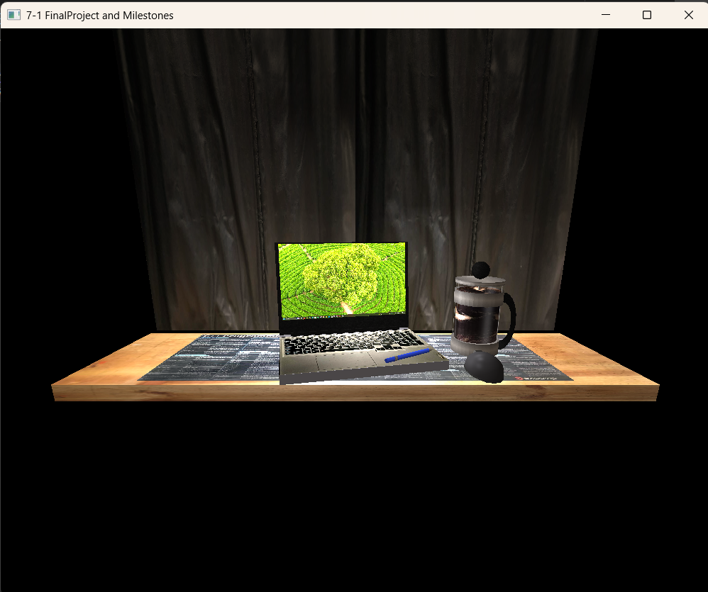

# CS-330 Computational Graphics and Visualization

**Shawn Ward** · Southern New Hampshire University · Fall 2026

A 3D recreation of my mobile workstation, built in C++ and modern OpenGL. I drive over the road for a living, and I do my coursework on a board laid across the pull-out table and console of my truck cab, in front of a black light-blocking curtain. That setup became the final project: a laptop, a French press, a pen, a mouse, and a mouse mat on the board, all built from basic shapes, textured from photos I took of the real objects, and lit with the Phong lighting model.

## Repository Contents

| Item | What it is |
|---|---|
| `Source/` | Final project source code and the textures made from my own photos |
| `CS330_Final_Design_Decisions.docx` | Design decisions document for the final project |
| `final-scene.png` | Screenshot of the rendered final scene |

## Controls (Final Scene)

| Input | Action |
|---|---|
| W / S | Move forward / back |
| A / D | Move left / right |
| Q / E | Move up / down |
| Mouse | Look around |
| Scroll wheel | Change movement speed |
| P / O | Perspective / orthographic view |

---

## Reflection

### How do I approach designing software?

**What new design skills has your work on the project helped you to craft?**
The biggest one was learning to break a real object down into primitives before writing any code. Looking at my French press and seeing a cylinder carafe, a sphere for the plunger knob, and a torus for the handle changed how I look at problems in general. I also got better at planning transformations, since scale, rotation, and translation have to be applied in the right order or the object ends up somewhere you didn't expect.

**What design process did you follow for your project work?**
I started with a photo of the real scene and picked it because it had a good variety of shapes, not because it was the easiest. From there I listed the major objects, mapped each one to basic shapes, and marked the areas I could simplify. I built one object at a time, starting with the most complex one (the French press), and only added textures and lighting once the geometry was in the right place.

**How could tactics from your design approach be applied in future work?**
Decomposing something complex into simple, reusable pieces applies to almost any software, not just graphics. The same habit of working from a reference, identifying the major components, and deciding up front what can be simplified is how I would approach a backend system or a user interface.

### How do I approach developing programs?

**What new development strategies did you use while working on your 3D scene?**
I learned to debug things I could see. When a sphere rendered with a small dent in it, I traced the problem back to the mesh generation math and reported it to my professor. A dark scene usually meant outdated shader files, and a stretched shape usually meant a scale or aspect ratio problem. Before any of that, I had to get my build environment working, which meant tracking down a Visual Studio setting that pointed to the wrong Windows SDK path. That taught me to check the toolchain before assuming the code was wrong.

**How did iteration factor into your development?**
Almost everything was iterative. I would change one transformation value, rebuild, look at the result, and adjust. Lighting took the most passes, since small changes to ambient, diffuse, and specular values made a big difference in how real the objects looked.

**How has your approach to developing code evolved throughout the milestones, which led you to the project's completion?**
Early on, I put everything into one long render function. By the end, I was splitting work into small functions for each object, keeping my changes inside the sections meant for student code, and using relative paths so the project would build on someone else's machine. Each milestone added one layer (shapes, then camera, then textures, then lighting), and building it in that order kept the project manageable.

### How can computer science help me in reaching my goals?

**How do computational graphics and visualizations give you new knowledge and skills that can be applied in your future educational pathway?**
This course gave me working experience with C++, linear algebra applied to real problems, and how the GPU fits into a program. Those carry into future courses on algorithms, systems, and anything involving simulation or performance.

**How do computational graphics and visualizations give you new knowledge and skills that can be applied in your future professional pathway?**
I'm working toward a career in software engineering, and being able to show a system visually is useful far beyond games. I want to use these skills to build visualizations for my own projects, including a hardware simulation where seeing the system in 3D makes it much easier to debug and explain. Understanding how rendering works on the GPU also gives me a foundation for the parallel computing that runs a lot of modern software.

## Author
Shawn Ward | [GitHub](https://github.com/nghtmanward) | [LinkedIn](https://linkedin.com/in/shawnward-8836b5340)
